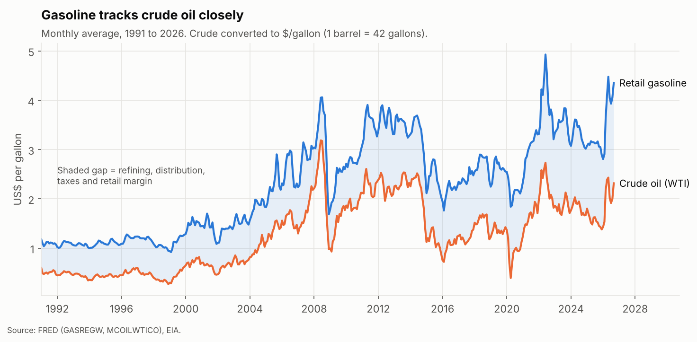
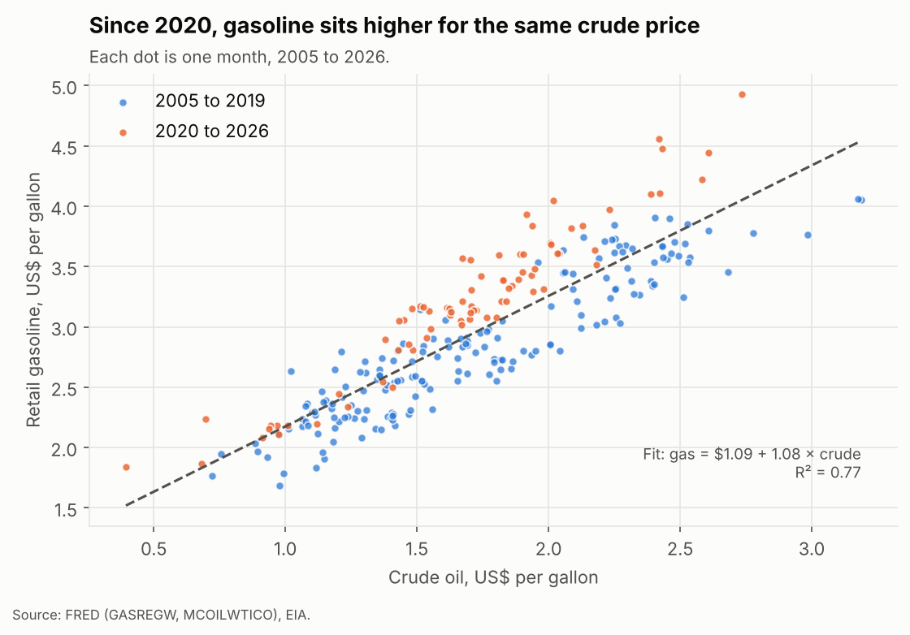
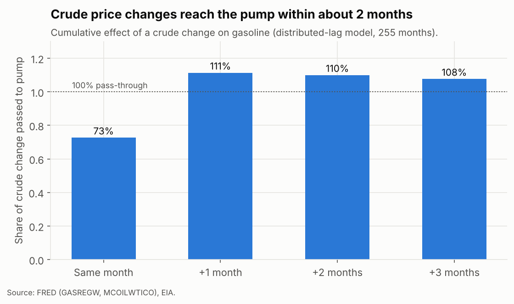
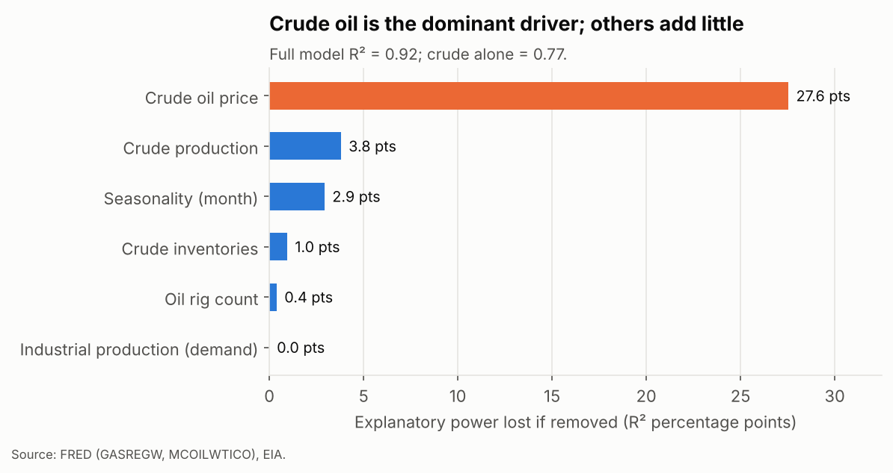
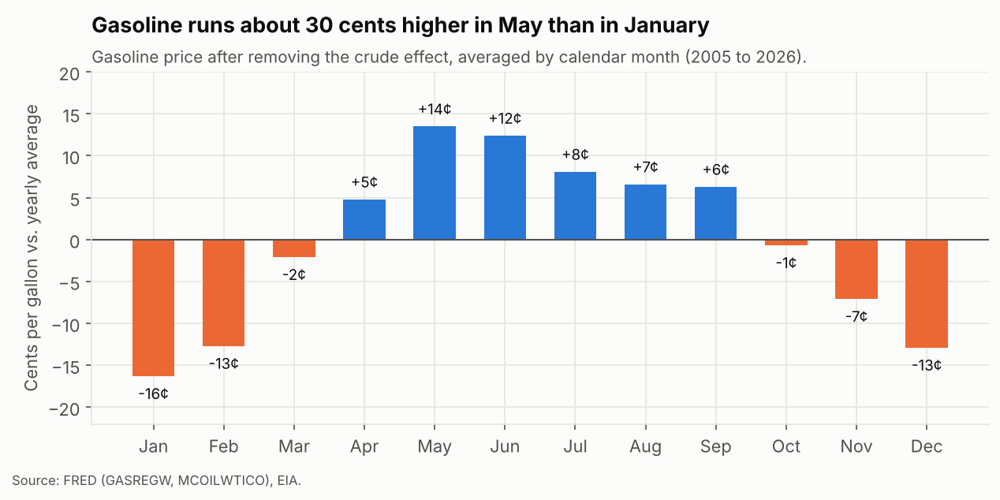
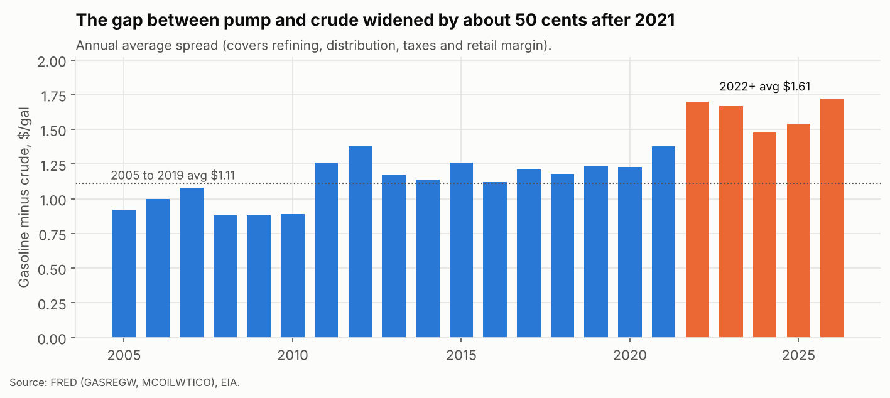
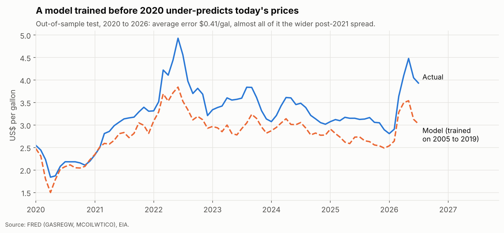

# What Drives U.S. Gasoline Prices?

**Energy market analysis · Python · Regression & time-series · Scenario modeling**

An analysis of 21 years of monthly U.S. data (2005 to 2026) to answer a question every fuel retailer, fleet manager, airline and household budget cares about: *when crude oil moves, what happens at the pump, how fast, and what else matters?*

- **Full walkthrough notebook:** [`notebooks/analysis.ipynb`](notebooks/analysis.ipynb), with code, charts and plain-English explanations step by step.
- **Live scenario tool:** https://jobayerdu00.github.io/oil-gas-price-drivers/ (move a slider to shock crude oil and see the modeled gasoline price, month by month).



---

## Key findings

| # | Finding | Evidence |
|---|---|---|
| 1 | **Crude oil explains most of the gasoline price.** On its own it explains 77% of month-to-month price levels. | R² = 0.77 (crude only) vs 0.92 (all drivers) |
| 2 | **Rule of thumb: +$1/barrel on crude ≈ +2.6¢/gallon at the pump.** Pass-through is about 108% of the crude cost, close to one-for-one. | Long-run pass-through 1.08 (SE 0.10) |
| 3 | **It's fast.** About 73% of a crude move reaches the pump in the same month, and essentially all of it by the next month. | Distributed-lag model, 255 months |
| 4 | **No measurable "rockets and feathers" at monthly frequency.** Pump prices did not rise significantly faster than they fell. | Up vs down gap, t ≈ 1.0 |
| 5 | **The pump-to-crude spread widened about 50¢ after 2021** (from $1.11 to $1.61/gal on average). A model trained on 2005 to 2019 under-predicts recent prices by about 41¢ for this reason. | Spread by year; out-of-sample backtest |
| 6 | **Seasonality is worth about 30¢/gal.** Prices peak in May to June and bottom out in January. | Month effects after removing crude |
| 7 | **Inventories, production, rig counts and the economy add little.** Higher crude inventories lower gas prices, but none of these move the needle once crude is known, and they do not improve out-of-sample forecasts. | Drop-one R², monthly change model |

### Scenario: crude oil from the September 2026 level ($97.31/bbl, gas $4.36/gal)

| Crude change | New WTI | Gas change, same month | Gas change, month +1 | Settled gas price (month +3) |
|---:|---:|---:|---:|---:|
| −30% | $68.12 | −$0.51 | −$0.77 | **$3.61** |
| −20% | $77.85 | −$0.34 | −$0.52 | **$3.86** |
| −10% | $87.58 | −$0.17 | −$0.26 | **$4.11** |
| +10% | $107.04 | +$0.17 | +$0.26 | **$4.60** |
| +20% | $116.77 | +$0.34 | +$0.52 | **$4.85** |
| +30% | $126.50 | +$0.51 | +$0.77 | **$5.10** |

---

## Business recommendations

- **Fuel budgeting (fleets, logistics, airlines):** Use the 2.6¢-per-$1 rule to translate crude futures into a fuel budget, and plan for the impact to land within one to two months, not a quarter.
- **Hedging:** Because pass-through is fast and near one-for-one, hedging crude is a reasonable proxy for hedging gasoline cost. The remaining risk sits in the retail spread, which crude hedges do not cover.
- **Retail pricing and forecasting:** Forecast models must track the spread separately. Models built on pre-2020 relationships are biased low by about 40 to 50 cents today.
- **Seasonal planning:** Expect roughly 30¢/gal more in late spring than in mid-winter, independent of crude.

---

## Charts

| | |
|---|---|
|  |  |
|  |  |
|  |  |

---

## Data

All public and free. Raw files are in `data/raw/`.

| Series | Source | ID | Frequency |
|---|---|---|---|
| U.S. regular gasoline retail price | FRED | GASREGW | Weekly → monthly avg |
| WTI crude oil price | FRED | MCOILWTICO | Monthly |
| Broad U.S. dollar index | FRED | DTWEXBGS | Daily → monthly avg |
| Industrial production index | FRED | INDPRO | Monthly |
| U.S. ending stocks of crude oil | EIA | MCRSTUS1 | Monthly |
| U.S. field production of crude oil | EIA | MCRFPUS2 | Monthly |
| U.S. crude oil rotary rigs | EIA | E_ERTRRO_XR0_NUS_C | Monthly |

The modeling window is January 2005 to July 2026 (259 months), set by the start of the EIA inventory series and the latest month with all drivers available.

## Method

1. **Levels model:** gasoline price regressed on crude ($/gal), inventories, production, rig count, industrial production and month dummies. Driver importance is measured as the R² lost when each driver is dropped.
2. **Pass-through speed:** a distributed-lag regression on monthly *changes* (crude changes in the same month and up to 3 months earlier, plus the other drivers). Working in changes avoids the spurious correlation that trending price levels can create.
3. **Asymmetry test:** crude changes split into increases and decreases, with a Wald test on whether their effects differ.
4. **Backtest:** models trained on 2005 to 2019 and tested on 2020 to 2026, compared with a naive "same as last month" benchmark.
5. **Scenarios:** the pass-through path from step 2 applied to crude shocks from the latest observed prices.

All regressions use Newey-West (HAC) standard errors because monthly price data are autocorrelated. Statistical code is plain NumPy so every step is visible.

## Limitations

- Monthly averages hide day-to-day dynamics. Weekly data may show some "rockets and feathers" asymmetry that monthly data cannot detect.
- The scenario tool holds the retail spread fixed. Refinery outages, hurricanes and tax changes move the spread and are not modeled.
- The dollar index was only available for October 2021 onward (60 months) and showed weak correlation with crude (0.09) and gasoline (0.14) over that window, so it is not in the main model.
- Crude production enters the levels model with a positive sign, which likely reflects its upward trend over time rather than a causal effect. It does not help out-of-sample.
- This is an explanatory model, not a short-term forecasting model. For next-month forecasts, last month's price (average error $0.15/gal) beats any of these structural models.

## How to run

The easiest way is to open `notebooks/analysis.ipynb` in Jupyter, VS Code or Google Colab and run all cells. To run the scripts instead:

```bash
pip install -r requirements.txt
python src/01_prepare_data.py   # build monthly table from data/raw
python src/02_analysis.py       # models, backtest, scenarios -> outputs/results.json
python src/03_charts.py         # charts -> outputs/figures/
```

The EIA `.xls` files were converted to `.xlsx` with LibreOffice (`soffice --headless --convert-to xlsx`). Both versions are included in `data/raw/`.

## Repository structure

```
oil-gas-price-drivers/
├── data/
│   ├── raw/                 # original FRED and EIA downloads
│   └── processed/           # cleaned monthly tables
├── src/
│   ├── 01_prepare_data.py
│   ├── 02_analysis.py
│   └── 03_charts.py
├── outputs/
│   ├── figures/             # PNG charts used above
│   ├── results.json         # every number cited in this README
│   ├── scenarios.csv
│   └── backtest_predictions.csv
├── notebooks/analysis.ipynb # full analysis, step by step
├── docs/index.html          # interactive scenario tool (GitHub Pages)
└── README.md
```

---

**Author:** Jobayer Ibne Saidur · Business Analytics, University of the Cumberlands · [GitHub @jobayerdu00](https://github.com/jobayerdu00)
